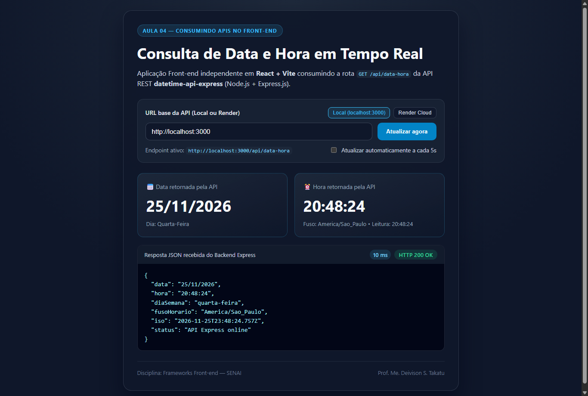

# 🌐 DateTime Frontend — Consumo da API de Data e Hora

Aplicação Front-end responsiva desenvolvida com **React** e **Vite** para consumir a API REST **[datetime-api-express](https://github.com/Enzootomas/datetime-api-express)** (`GET /api/data-hora`), atendendo integralmente à **Atividade 02 da Aula 04 (Consumindo APIs no Front-end)** da disciplina de **Frameworks Front-end** (SENAI).

- **Deploy em Produção (Vercel):** [🌐 Ver online](https://datetime-frontend-rose.vercel.app)
- **Repositório GitHub:** [🔗 Repositório](https://github.com/Enzootomas/datetime-frontend)

---

## 📸 Captura de Tela da Aplicação em Funcionamento



---

## 🎯 Descrição da Atividade

Desenvolver uma aplicação Front-end em repositório separado para consumir a rota de consulta de data e hora criada em **Node.js + Express.js**, exibindo a data e o horário atual na interface, tratando estados de carregamento/erro e inspecionando o payload JSON retornado pelo servidor.

---

## ✨ Funcionalidades Implementadas

- Consulta assíncrona ao endpoint `GET /api/data-hora` utilizando `fetch` e `async/await`;
- Exibição destacada da **data**, **hora** e **dia da semana** atuais no fuso `America/Sao_Paulo`;
- Atalhos rápidos e campo configurável para alternar entre servidor local (`http://localhost:3000`) e serviço publicado no **Render**;
- Medição em milissegundos da latência HTTP da requisição;
- Opção de atualização automática a cada 5 segundos com limpeza de `setInterval` no `useEffect`;
- Visualização formatada do payload **JSON** retornado pelo servidor Express;
- Tratamento completo dos estados de carregamento (`loading`) e falha de conexão (`error`);
- Layout moderno e responsivo para desktop, tablet e dispositivos móveis.

---

## 🛠️ Tecnologias Utilizadas

- React 19
- Vite 7
- JavaScript (ES6+)
- CSS3 Responsivo (Flexbox, CSS Grid e Media Queries)
- Fetch API / JSON

---

## 📁 Estrutura de Diretórios

```text
datetime-frontend/
├── docs/
│   └── screenshot-app.png   # Captura real da aplicação integrada à API
├── src/
│   ├── App.jsx              # Componente principal e lógica de consumo HTTP
│   ├── main.jsx             # Ponto de entrada React
│   └── styles.css           # Estilização responsiva
├── .env.example             # Exemplo de variável VITE_API_BASE_URL
├── .gitignore
├── index.html
├── package.json
├── vercel.json              # Configuração de rotas SPA para Vercel
├── vite.config.js
└── README.md
```

---

## 🚀 Instruções de Instalação e Execução

### 1. Iniciar a API Express (`datetime-api-express`)

Em um terminal separado, inicie o backend na porta `3000`:

```bash
git clone https://github.com/Enzootomas/datetime-api-express.git
cd datetime-api-express
npm install
npm start
```

### 2. Instalar e executar o Front-end (`datetime-frontend`)

```bash
git clone https://github.com/Enzootomas/datetime-frontend.git
cd datetime-frontend
npm install
npm run dev
```

Acesse o endereço exibido pelo Vite (geralmente `http://localhost:5173`).

Para gerar o build otimizado de produção:

```bash
npm run build
```

---

## ☁️ Configuração para Deploy na Vercel

1. Publique a API `datetime-api-express` no **Render** e copie a URL gerada (ex.: `https://datetime-api-express.onrender.com`).
2. Importe este repositório na **Vercel** (preset **Vite**).
3. Configure opcionalmente a variável de ambiente `VITE_API_BASE_URL` com a URL pública do Render (ou selecione o botão **Render Cloud** diretamente na interface).

---

## 🔗 Repositórios Relacionados

- **Back-end (API Express):** [https://github.com/Enzootomas/datetime-api-express](https://github.com/Enzootomas/datetime-api-express)
- **Central da Disciplina:** [https://github.com/Enzootomas/frontend-learning-hub](https://github.com/Enzootomas/frontend-learning-hub)

---

## 🎓 Disciplina

**Frameworks Front-end** — Curso Superior de Tecnologia em Análise e Desenvolvimento de Sistemas (SENAI)  
**Professor:** Me. Deivison S. Takatu
